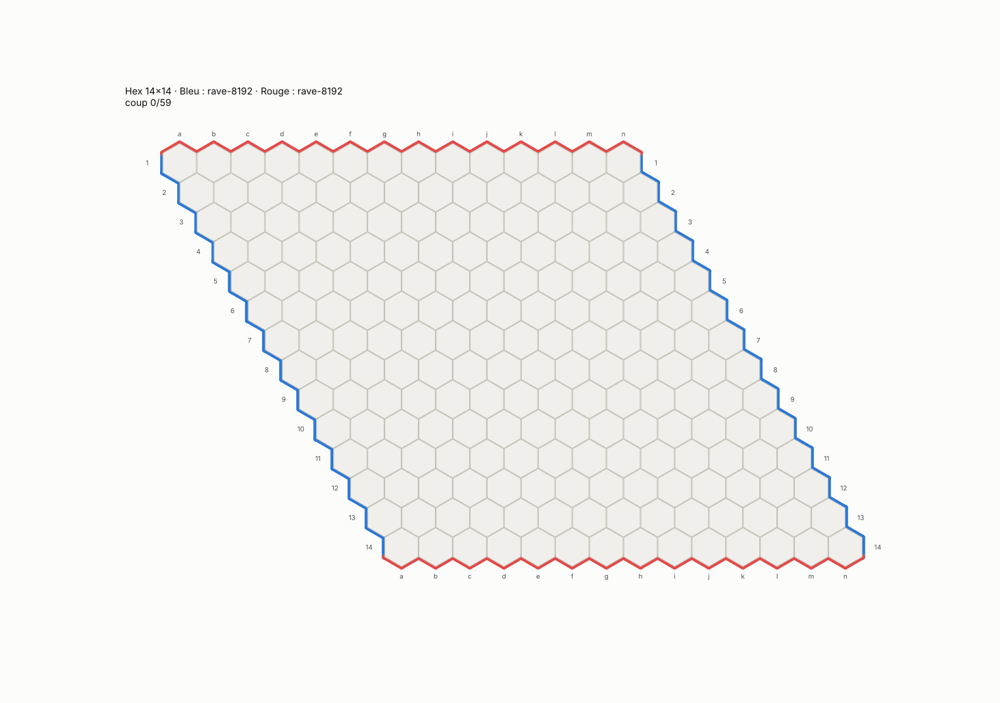
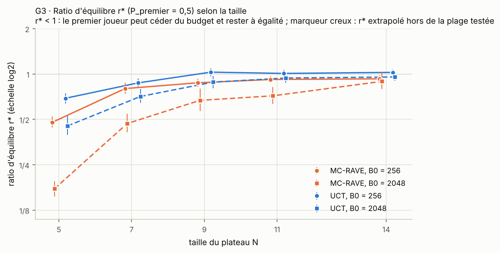
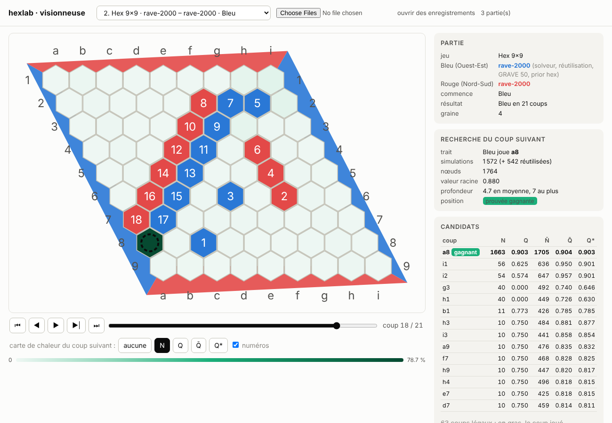

<h1 align="center">HexBandit</h1>

<p align="center">
  <strong>Deux intelligences artificielles s'affrontent au Hex. L'une réfléchit deux fois plus que l'autre.<br>
  Combien de calcul vaut le simple fait de jouer en premier ?</strong>
</p>

<p align="center">
  
  
  
  
</p>

<p align="center">
  
  <br><em>MC-RAVE contre MC-RAVE, 8 192 simulations par coup, sur un plateau 14 × 14.</em>
</p>

Au Hex, chaque joueur tente de relier ses deux bords du plateau ; une partie ne peut pas finir nulle, et le premier joueur gagne toujours en jeu parfait. Ce projet fait jouer des IA de **recherche arborescente de Monte-Carlo** (UCT, et MC-RAVE de Gelly et Silver) avec des budgets de calcul inégaux, sur plus de **86 000 parties**, pour mesurer ce que vaut l'avantage du trait exprimé en simulations : c'est le **ratio d'équilibre r\***, le budget que le premier joueur peut céder tout en restant à 50 % de victoires.

## Ce qui a été découvert



* **En 5 × 5, jouer en premier vaut presque six fois plus de calcul.** Le premier joueur peut se contenter de 17 % du budget de son adversaire et rester à égalité (MC-RAVE, 2 048 simulations). En 14 × 14, ce n'est plus que 7 à 11 % de calcul.
* **Sur un grand plateau, chaque simulation compte davantage.** Doubler le budget rapporte 120 points Elo à UCT en 5 × 5 et près de 500 en 14 × 14, tandis que la valeur du trait s'effondre : r\* ≈ 2^(-trait/doublement) tend vers 1.
* **La règle du gâteau ne suffit pas.** Elle efface l'avantage en 5 × 5, mais sur les grands plateaux les IA n'échangent presque jamais l'ouverture (0 à 3 % des parties en 14 × 14) : il faut savoir juger une ouverture pour que la règle serve.
* **MC-RAVE écrase UCT** : de 93,5 à 100 % de victoires à budget égal. La connaissance des ponts du Hex ou GRAVE y ajoutent encore une cinquantaine d'Elo.
* **Un plan d'expérience adaptatif** retrouve les mêmes r\* avec 1,4 à 9 fois moins de parties qu'une grille fixe.

Tout est détaillé, chiffré et sourcé dans le [rapport scientifique](docs/rapport_scientifique.md).

<br clear="right">

## Essayer en trois commandes

Prérequis : [Rust](https://rustup.rs) (la toolchain du projet s'installe seule), Python ≥ 3.11 avec le module `venv` (`sudo apt install python3-venv` sous Debian et Ubuntu) et `make`.

```sh
make installer      # une fois : environnement Python (.venv) et moteur Rust
make demo           # une partie IA contre IA : image, animation GIF, visionneuse web
make visionneuse    # ouvre la visionneuse d'exemple dans votre navigateur
```

`make demo` écrit dans `demo/` la partie (`partie.json`), sa position finale (`partie.png`), son animation (`partie.gif`) et une page autonome (`visionneuse.html`) pour la rejouer coup par coup, avec les cartes de chaleur des visites et des valeurs de chaque coup envisagé.

<p align="center">
  
  <br><em>La visionneuse : ici le solveur a prouvé le coup gagnant (en vert), en réutilisant 542 visites du coup précédent.</em>
</p>

## Que voulez-vous faire ?

| Envie | Commande |
|---|---|
| Voir deux IA s'affronter | `make demo` |
| Choisir la taille et les joueurs | `make demo TAILLE=13 BLEU=rave:5000 ROUGE=uct:5000` |
| Jouer à Chameleon (pierres des deux couleurs) | `make demo JEU=chameleon TAILLE=7` |
| Comparer deux IA sur 500 parties | `make match A=rave:1000,grave=50 B=rave:1000 PARTIES=500` |
| Classer six IA en points Elo | `make tournoi` |
| Reproduire la campagne puis son rapport | `make campagne` puis `make rapport` |
| Vérifier que les parties se rejouent à l'identique | `make determinisme` |
| Lancer tous les contrôles de la CI | `make verifier` |
| Mesurer la vitesse du moteur | `make bench` |

`make` seul affiche toutes les cibles et leurs paramètres (`TAILLE`, `BLEU`, `ROUGE`, `JEU`, `A`, `B`, `PARTIES`, `CAMPAGNE`, `RESULTATS`, `THREADS`…). La bibliothèque native n'est recompilée que si une source Rust a changé. Avec une autre toolchain Rust que celle du projet (≥ 1.85) : `make demo TOOLCHAIN=stable`.

## Contenu

* **Un moteur Rust rapide et générique** : jusqu'à 480 000 simulations par seconde pour UCT et 135 000 pour MC-RAVE sur un cœur, en 14 × 14. Le moteur ne connaît que deux traits, `Game` et `AmafGame` : ajouter un jeu ne touche pas une ligne de la recherche ([guide](docs/guide_ajouter_un_jeu.md)).
* **Des parties reproductibles au bit près** : chaque partie est déterminée par sa configuration et sa graine, quel que soit le nombre de threads, et le moteur n'appelle plus la bibliothèque mathématique du système (vérifié sous Linux, rejoué par la CI sous macOS et Windows).
* **Toute la famille MCTS** : UCT, MC-RAVE (plannings de β des éq. 19 et 47),
  GRAVE, MCTS-Solver, réutilisation de l'arbre, parallélisme à la racine, connaissance a priori du Hex (cases mortes, ponts, gabarits de bord), choix final « secure » et « max-robust ».
* **Cinq jeux** : Hex, Reverse Hex, Hex avec règle du gâteau, Chameleon et Quarto (coups composés, parties nulles).
* **Un laboratoire statistique en Python** (`hexbandit`) : campagnes TOML reprenables et réparties sur plusieurs machines, régression logistique de Firth, modèle mixte, splines monotones, échelle Elo de Bradley-Terry, plan adaptatif bayésien, graphiques, tournois.
* **Qualité** : tests de propriétés et de contrat, empreintes des arbres complets, mypy strict, CI sous Linux, macOS et Windows, roues Python pour chaque plateforme.

```
crates/game-core          traits Game/AmafGame, aléatoire, logarithme portable, décorateurs, tests de contrat
crates/game-hex           plateau, union-find, notation, motifs (ponts, cases mortes), simulation optimisée
crates/game-chameleon     variante Chameleon
crates/game-quarto        variante Quarto
crates/mcts               UCT, MC-RAVE, GRAVE, solveur, réutilisation, parallélisme, budgets, matchs
crates/bindings           façade JSON, registre des jeux et des joueurs, ABI C (libhexbandit_native)
python/hexbandit             domaine, moteur, expériences, statistiques, visualisation, ligne de commande
experiments/  results/    plans d'expérience TOML et données brutes (une ligne par partie)
docs/                     rapport scientifique, décisions d'architecture (ADR), guide, figures
scripts/  Makefile        construction, contrôles, campagnes
```

## La ligne de commande `hexbandit`

Les cibles `make` ne font qu'appeler `python -m hexbandit` (depuis `python/`) et les scripts de `scripts/`. Pour aller plus loin, après `source .venv/bin/activate` :

```sh
python -m hexbandit play --size 11 --blue rave:2000 --red uct:2000,c=0.25 --out partie.json --image partie.png --gif partie.gif # une partie
python -m hexbandit replay partie.json --mp4 partie.mp4 --heatmap 10                                                            # rejeu, carte de chaleur
python -m hexbandit view partie.json --out parties.html                                                                         # visionneuse web
python -m hexbandit search --size 5 --moves a1,c2,b1,c3 --player rave:3000                                                      # analyse d'une position
python -m hexbandit match --size 9 --a rave:1000,prior=hex --b rave:1000 --games 200
python -m hexbandit tournament experiments/tournoi_9x9.toml --out results/tournoi_9x9
python -m hexbandit --version                                                                                                   # diagnostic
```

Un joueur s'écrit `algorithme:simulations[,option=valeur…]`, par exemple `rave:2000,prior=hex,grave=50,solver,reuse`.

| Option | Effet |
|---|---|
| `c`, `beta` (`mse`, `manual`, `none`), `bias`, `k` | exploration d'UCT, planning de β de MC-RAVE |
| `rollout` (`fill`, `uniform`) | politique de simulation |
| `final` (`most_visited`, `best_value`, `secure`, `max_robust`), `secure_a` | choix du coup joué |
| `time`, `nodes`, `expand` | budget en millisecondes, limite de nœuds, seuil d'expansion |
| `solver`, `reuse`, `grave=R`, `trees=K` | options de recherche ([ADR 0008](docs/adr/0007-extensions-de-recherche.md)) |
| `prior=hex`, `prior=even:M`, `prior.dead=…` | connaissance a priori ([ADR 0009](docs/adr/0008-connaissance-a-priori-hex.md)) |
| `label` | nom affiché |

## Reproduire les résultats

Chaque partie est déterminée par la graine maître de sa campagne et l'identifiant de sa cellule : relancer une campagne redonne exactement les mêmes parties, quel que soit le nombre de threads ou de machines, et une campagne interrompue reprend où elle s'était arrêtée.

| Données | Commande | Résultats |
|---|---|---|
| Campagne réduite (48 600 parties, 41 min sur 2 cœurs) | `make campagne` | `results/reduite` |
| Campagne complète (52 200 parties à ce jour) | voir ci-dessous | `results/complete` |
| Règle du gâteau (34 200 parties) | `make gateau` | `results/gateau` |
| Plan adaptatif de r* (26 480 parties) | `make adaptatif` | `results/adaptatif` |
| Tournoi des options (3 000 parties) | `make tournoi` | `results/tournoi_9x9` |
| Matchs de validation | `make validation` | `experiments/validation` |

`make estimer CAMPAGNE=…` chiffre le coût d'un plan avant de le lancer. La campagne complète (180 cellules × 1 000 parties) réutilise les parties de la campagne réduite et se répartit sur plusieurs machines :

```sh
cd python
# lot 1 sur 4 ; idem 2/4, 3/4, 4/4
python -m hexbandit run-campaign ../experiments/campagne_complete.toml --results ../results/complete --source ../results/reduite --shard 1/4 --threads 8
python -m hexbandit report ../results/complete
```

## Installation sans `make`

Sous Windows sans `make`, ou pour tout faire à la main (Git Bash convient) :

```sh
bash scripts/hexlXtc01.sh release     # compile la bibliothèque native dans python/hexbandit/_lib
bash scripts/hexlXtc03.sh             # crée .venv et y installe hexbandit (accès PyPI)
bash scripts/hexlXtc02.sh             # tous les contrôles : normes shell, fmt, clippy, tests, ruff, mypy, pytest
bash scripts/hexlXtc04.sh dist        # roue py3-none-<plateforme>, pour toutes les versions de Python
```

Les scripts choisissent l'interpréteur dans l'ordre `HEXBANDIT_PYTHON`, environnement virtuel actif, `.venv`, `python3`.

## Format d'enregistrement

Chaque partie est un JSON versionné (`format: "hexbandit/game-record"`, `format_version: 1`) : jeu, premier joueur, graine, configuration normalisée des deux joueurs, coups numérotés avec le rapport de recherche (simulations, nœuds, profondeurs, valeur de la racine et, au niveau `full`, N, Q, Ñ, Q̃ et Q* de chaque candidat ; visites réutilisées et preuve du solveur quand ces options sont actives), vainqueur, durée. La visualisation ne lit que ce format.

## Documentation

* [Rapport scientifique](docs/rapport_scientifique.md) - question, protocole, résultats, limites
* [Guide : ajouter un jeu](docs/guide_ajouter_un_jeu.md) - pas à pas, avec Chameleon
* Décisions d'architecture :
  [0001](docs/adr/0001-architecture.md) architecture et patterns ·
  [0002](docs/adr/0002-pont-abi-c.md) pont ABI C et PyO3 ·
  [0003](docs/adr/0003-arbre-et-memoire.md) arbre, mémoire, performance ·
  [0004](docs/adr/0004-reglages-uct-rave.md) réglages ·
  [0005](docs/adr/0005-semantique-mcts-rave.md) sémantique des algorithmes ·
  [0006](docs/adr/0006-determinisme-multiplateforme.md) déterminisme multiplateforme ·
  [0007](docs/adr/0007-extensions-de-recherche.md) solveur, GRAVE, parallélisme ·
  [0008](docs/adr/0008-connaissance-a-priori-hex.md) connaissance du Hex ·
  [0009](docs/adr/0009-variante-chameleon.md) Chameleon ·
  [0010](docs/adr/0010-statistiques.md) Statistiques

## Contribuer

Avant de proposer une modification, `make verifier` lance les mêmes contrôles que la CI. Les scripts shell suivent les normes du projet, vérifiées par `make normes`. Pour un nouveau jeu, suivez le [guide](docs/guide_ajouter_un_jeu.md) : le moteur ne doit pas changer.