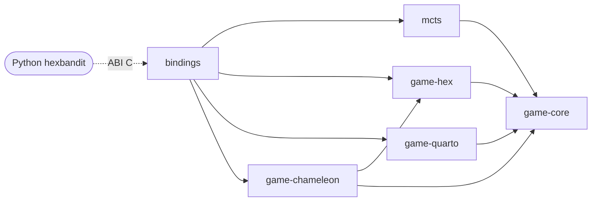

# ADR 0001 - Architecture Rust + Python

> **En bref.** Rust pour tout ce qui calcule (règles, recherche, simulations),
> Python pour tout ce qui analyse (plans d'expériences, statistiques,
> graphiques), un seul point de contact entre les deux. Le moteur ne dépend
> que d'abstractions : ajouter un jeu ne touche jamais la recherche.

## Contexte

Le projet combine une partie coûteuse (règles, recherche MCTS, millions de simulations) et une partie scientifique (plans d'expériences, statistiques, graphiques).  Rust pour la première et Python pour la seconde, avec un seul point de contact.

## Décision

### Côté Rust : un workspace dont les dépendances vont vers les abstractions

| Crate | Rôle |
|---|---|
| `game-core` | `Player`, `Outcome`, `GameError`, traits `Game` et `AmafGame`, générateur aléatoire, politiques de simulation (`RolloutPolicy`), décorateurs génériques (`Misere`, `SwapRule`), tests de contrat ; logarithme portable `math` |
| `game-hex` | plateau, union-find, notation, rendu ASCII, simulation optimisée pour le Hex ; motifs (`patterns`) |
| `game-quarto`, `game-chameleon` | variantes, sans dépendance au moteur |
| `mcts` | moteur générique sur `G: Game` : UCT, MC-RAVE et GRAVE, plannings de β, budgets, choix final, solveur, observateurs, orchestration des parties et des matchs |
| `bindings` | seul point de composition (registre, fabrique de joueurs), configuration JSON validée, façade `play_game` / `play_batch` / `search`, ABI C |

* `RolloutPolicy` est défini dans `game-core` (et non dans `mcts`) pour que `game-hex` puisse fournir sa politique optimisée sans dépendre du moteur : le graphe reste `mcts → game-core ← game-hex`.
* `#![forbid(unsafe_code)]` dans les crates du cœur ; le seul code `unsafe` est la lecture des pointeurs C dans `bindings::ffi`.
* Aucune entrée-sortie dans les crates du cœur ; le journal et l'ABI sont dans `bindings`.

### Côté Python : une architecture hexagonale

| Couche | Contenu |
|---|---|
| Domaine | types, Protocols `EnginePort`, `ResultsRepository`, `Renderer` |
| Adaptateurs | `engine.native`, `engine.fake`, `experiments.repository`, `viz` |
| Cas d'usage | `experiments.campaign`, `experiments.analysis` |
| Interface | `cli` (`python -m hexbandit`) |

## Conséquences

Ajouter un jeu ne touche ni `mcts` ni `game-core` (voir le [guide](../guide_ajouter_un_jeu.md)) ; Reverse Hex n'a demandé qu'un alias de type dans `game-hex` et une ligne dans le registre de `bindings`.

---

[Index des ADR](README.md) · [ADR 0002 →](0002-pont-abi-c.md)

