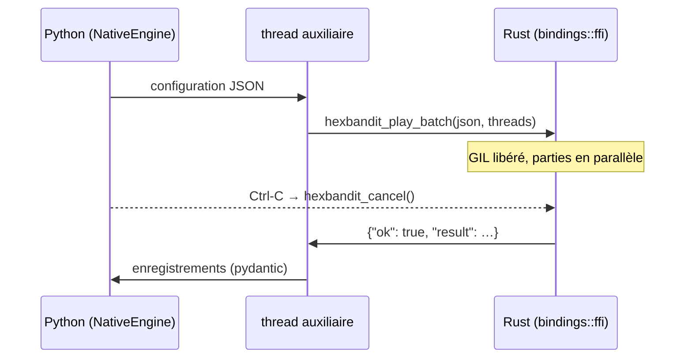

# ADR 0002 - Pont Rust ↔ Python par ABI C et ctypes

> **En bref.** Faute de PyO3 hors ligne, le moteur est une bibliothèque
> partagée à l'ABI C, appelée depuis Python par `ctypes`, avec du JSON à
> l'aller comme au retour. Le GIL est libéré pendant le calcul, Ctrl-C
> interrompt proprement, et la migration vers PyO3 tient en trois étapes.

## Décision

Le crate `bindings` est compilé en bibliothèque partagée (`libhexbandit_native.so`, `.dylib`, `hexbandit_native.dll`) exposant une ABI C :

| Fonction | Rôle |
|---|---|
| `hexbandit_play_game(config)` | une partie, renvoie l'enregistrement |
| `hexbandit_play_batch(request, threads)` | lot (`games`) ou match (`match`) en parallèle |
| `hexbandit_search(request)` | recherche sur une position (carte de chaleur) |
| `hexbandit_version()` | versions du moteur et des formats |
| `hexbandit_cancel()` | interruption du calcul en cours |
| `hexbandit_free_string(s)` | libération des chaînes renvoyées |

**Un protocole JSON.** Entrées et sorties sont des chaînes JSON UTF-8. Les réponses ont la forme `{"ok": true, "result": ...}` ou `{"ok": false, "error": {"kind", "message"}}` ; `kind` (`config`, `game`, `search`, `cancelled`, `internal`) devient une exception Python typée. Les paniques sont interceptées (`catch_unwind`) et ne traversent jamais la frontière.

**Côté Python**, `hexbandit._native` charge la bibliothèque avec `ctypes`, qui libère le GIL pendant l'appel. L'appel s'exécute dans un thread auxiliaire ; le thread principal reste interruptible et transforme Ctrl-C en `hexbandit_cancel()`, puis relance `KeyboardInterrupt` une fois le moteur arrêté. Les configurations restent validées côté Rust, source de vérité.

## Migration vers PyO3

La façade (`bindings::facade::{play_game, play_batch, search}`) prend et rend déjà du JSON. Une version PyO3 se limite à :

1. ajouter `pyo3 = { version = "0.30", features = ["extension-module"] }` et un module `#[pymodule] fn _native(...)` qui appelle la façade dans `py.detach(|| ...)` et convertit le JSON en `dict` ;
2. passer `pyproject.toml` au backend maturin (`module-name = "hexbandit._native"`) ;
3. supprimer `hexbandit/_native.py` : le reste du paquet n'utilise que `hexbandit.engine.native.NativeEngine`, qui garde la même interface.

## Conséquences

Pas de roue cp315 construite par maturin : la bibliothèque est compilée par `scripts/hexlXtc01.sh` (ou `make lib`) et copiée dans `python/hexbandit/_lib`, d'où elle est embarquée par setuptools (`package-data`).

---

[← ADR 0001](0001-architecture.md) · [Index des ADR](README.md) · [ADR 0003 →](0003-arbre-et-memoire.md)

