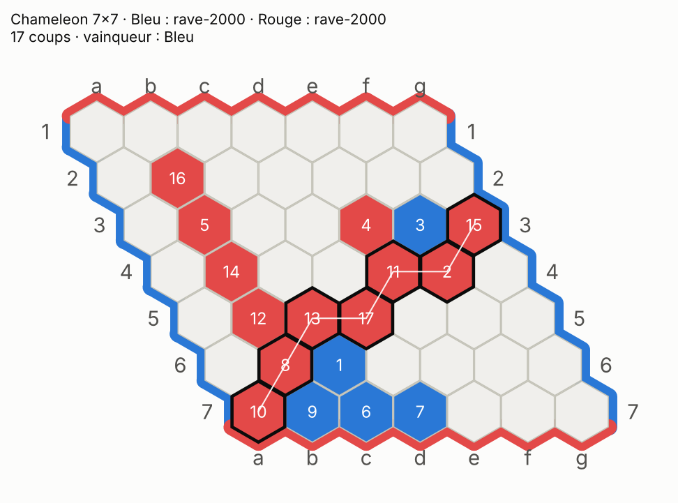

# ADR 0009 - Variante Chameleon

> **En bref.** Chameleon est un Hex où chaque joueur pose des pierres **des
> deux couleurs**. Il a été ajouté sans toucher une ligne du moteur ni de
> `game-core`, et MC-RAVE y bat UCT aussi nettement qu'au Hex (95,7 % des parties).

  
   <em>Chameleon 7 × 7, MC-RAVE contre MC-RAVE : Bleu (Ouest-Est) gagne avec une chaîne… de pierres rouges.</em>

## La règle

Chameleon a été trouvé par Randy Cox début novembre 2003 (d'abord appelé *Goofy Hex* puis *Funky Hex*) et redécouvert indépendamment par Bill Taylor à la mi-novembre 2003 d'après une idée de Cameron Browne, pour le concours de conception de jeux à pièces partagées de 2003 ([sources](#sources) ; HexWiki, n'était pas joignable depuis l'environnement de développement).

1. Plateau en losange du Hex ; deux joueurs, **Horz** (relie Ouest et Est) et **Vert** (relie Nord et Sud).
2. À son tour, un joueur pose une pierre **de l'une ou l'autre couleur** sur une case vide : les pierres n'appartiennent à personne.
3. Horz gagne dès qu'une chaîne de pierres d'**une même couleur** relie Ouest et Est ; Vert dès qu'une chaîne d'une même couleur relie Nord et Sud.
4. Si un coup crée les deux connexions à la fois, **celui qui l'a joué gagne**.
5. Règle du gâteau facultative : la page de référence la mentionne comme secondaire (« pour l'expérimentation »).

**Conventions du projet.** Horz est Bleu (`BLUE`, premier joueur) et Vert est Rouge, comme au Hex de la V1 où Bleu relie Ouest et Est. La page de référence fait jouer Vert en premier ; les deux conventions sont équivalentes par transposition du plateau. Un plateau plein contient toujours une chaîne gagnante d'une couleur (propriété du Hex appliquée aux couleurs des pierres) : pas de partie nulle.

## Décision d'implémentation

Crate `game-chameleon`, sans aucune modification du crate `mcts` ni de `game-core` (critère de généricité).

| Aspect | Choix |
|---|---|
| Coup | composé, `ChameleonMove { cell, color }` ; notation `c4b` (bleue), `c4r` (rouge) ou `c4:blue` ; la case et sa notation viennent de `game-hex` |
| Connexité | un union-find par couleur ; chaque racine retient le masque des bords touchés (Ouest, Est, Nord, Sud) |
| RAVE | `AmafGame` avec l'indice `case × 2 + couleur` (2 N² indices) : un coup a le même sens dans toutes les positions, contrairement au Quarto |
| Simulation | politique uniforme générique : pas d'astuce de remplissage, la fin de partie dépend de l'ordre des coups et du joueur qui les joue |
| Règle du gâteau | `PieGame` transpose la première pierre (r, c) → (c, r) en gardant sa couleur, ce qui échange les rôles Ouest-Est et Nord-Sud |
| Exposition | partout où le Hex l'est : configuration (`"kind": "chameleon"`), CLI (`--kind chameleon`), campagnes (`kind = "chameleon"`), enregistrement des parties, images, animations et visionneuse web (pierres des deux couleurs, dernier joueur indiqué), prior « partie équilibrée » ; les priors propres au Hex ([ADR 0008](0008-connaissance-a-priori-hex.md)) ne s'appliquent pas |

> [!WARNING]
> **Pourquoi pas de nœuds virtuels de bord, comme au Hex ?** Deux chaînes
> touchant le Nord y seraient réunies, et une chaîne Ouest-Nord plus une
> chaîne Nord-Est passeraient pour une chaîne Ouest-Est. Cette erreur a été
> trouvée par le test de recoupement ci-dessous et corrigée avant livraison.

## Tests

`crates/game-chameleon/tests/contract.rs` et tests unitaires :

* contrats génériques du projet (`game_core::contract`), dont l'AMAF ;
* les deux couleurs d'une même case ont des indices AMAF distincts ;
* **3 000 parties aléatoires** de 2 × 2 à 7 × 7 : le résultat calculé de façon incrémentale est recoupé après chaque coup par un parcours en largeur complet du plateau (deux couleurs, quatre bords), cas « deux connexions d'un coup » compris ; un plateau plein a toujours un vainqueur ;
* 4 000 simulations uniformes en 5 × 5 : jamais de nul, et chaque camp en gagne plus de 1 000 ;
* coup créant les deux connexions : victoire du joueur qui le joue, quel que soit le premier joueur ;
* règle du gâteau : transposition, couleur gardée, échange unique.

## Conséquences

* **MC-RAVE s'applique à un jeu à coups composés sans changer le moteur**, et avec la même efficacité qu'au Hex : il bat UCT (c = 0,25) dans 95,7 % [94,3 ; 96,8] des 1 000 parties en 7 × 7 à 1 000 simulations par coup (`scripts/hexlXcp03.sh`, `experiments/validation/chameleon.json`).
* Le [guide « ajouter un jeu »](../guide_ajouter_un_jeu.md) prend Chameleon pour exemple (amélioration 8.2).
* Sur petits plateaux, Chameleon tourne à la course (la page de référence conseille 10 × 10 et plus) : les matchs de validation en 7 × 7 mesurent la force relative des IA, pas l'intérêt du jeu.

Pour essayer : `make demo JEU=chameleon TAILLE=7`.

## Sources

* Règles et historique : page Chameleon des *World of Abstract Games* (J. P. Neto, d'après C. Rognlie), <https://jpneto.github.io/world_abstract_games/rognlie/chameleon.html>.
* Présentation des règles : *Chameleon*, blog TabTop (9 juin 2009), <https://tabtop.blogspot.com/2009/06/chameleon.html>.

---

[← ADR 0008](0008-connaissance-a-priori-hex.md) · [Index des ADR](README.md) · [ADR 0010 →](0010-statistiques.md)

