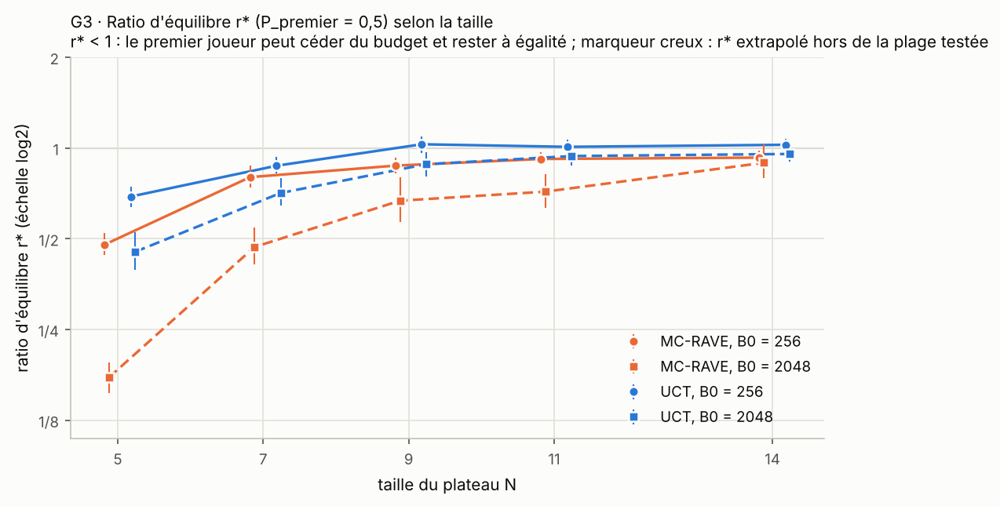

# Rapport scientifique - Rapport de budget et victoire au Hex avec UCT et MC-RAVE

> **La question.** Au Hex, le premier joueur gagne toujours en jeu parfait.
> Mais entre deux IA imparfaites, combien de calcul vaut le fait de jouer en
> premier ? On fait s'affronter des joueurs MCTS (UCT, MC-RAVE) aux budgets
> inégaux et l'on cherche le **ratio d'équilibre r\***, le rapport de budget
> qui ramène le premier joueur à 50 % de victoires : si r* = 0,8, il peut
> céder 20 % de son budget et rester à égalité.

**Sommaire** - [Résumé](#résumé) ·
[1. Question et définitions](#1-question-et-définitions) ·
[2. Moteur et validation](#2-moteur-et-validation) ·
[3. Protocole](#3-protocole-expérimental) ·
[4. Résultats](#4-résultats) ·
[5. Discussion](#5-discussion) ·
[6. Limites](#6-limites) ·
[7. Reproduction](#7-reproduction) ·
[8. Compléments](#8-compléments) ·
[Références](#références)

<details>
<summary><strong>Où sont les données ?</strong></summary>

| Données | Parties | Rapport complet régénérable |
|---|---|---|
| `results/reduite` | 48 600 | `hexbandit report results/reduite` → `results/reduite/rapport/resultats.md` |
| `results/complete` (reduite + 18 cellules) | 52 200, dont les précédentes | `results/complete/rapport/resultats.md` |
| `results/gateau` (règle du gâteau) | 34 200 | `results/gateau/rapport/resultats.md` |
| `results/adaptatif` (plan adaptatif de r*) | 26 480 | `results/adaptatif/rapport/resultats.md` |
| `results/tournoi_9x9`, `experiments/validation` | tournoi et matchs de contrôle | - |

Les figures reproduites ici sont des copies de celles des rapports (`docs/figures/rapport/`).
</details>

## Résumé

### Premiers Résultats

Deux joueurs MCTS de même algorithme (UCT ou MC-RAVE) s'affrontent au Hex ; le premier joueur dispose de r fois le budget de simulations du second. Sur 48 600 parties (5 tailles de plateau, 9 rapports de budget de 1/16 à 16, 2 budgets de base, 2 algorithmes) :

1. **Le rapport de budget domine l'avantage du trait.** À budgets égaux, le premier joueur gagne entre 48 % et 92 % des parties selon la configuration. Avec moitié moins de budget que l'adversaire, il tombe à 5-54 % dans 17 groupes sur 18 (79 % pour MC-RAVE à 2 048 simulations en 5 × 5) ; avec le double, il monte à 71-96 %.
2. **La sensibilité au budget croît avec la taille du plateau.** La pente du logit par doublement du rapport passe d'environ 1 en 5 × 5 à 2,6 en 14 × 14.
3. **L'effet est asymétrique.** Perdre du budget coûte plus qu'en gagner ne rapporte (pente b₋ > b₊ dans 10 groupes sur 18) : les rendements des simulations sont décroissants. Le modèle logistique linéaire en log₂ r est mal spécifié : il conclut à r* > 1 dans 4 groupes, dont 3 où les données indiquent au contraire r* < 1. Un modèle à deux pentes corrige ce biais.
4. **Le premier joueur peut céder du budget et rester à égalité (H2).** Le ratio d'équilibre r* est significativement inférieur à 1 dans 14 groupes sur 18, et jamais supérieur à 1. Mais cet avantage, mesuré en budget, **s'amenuise quand N grandit (H3)** : r* passe de 0,17-0,69 en 5 × 5 à 0,72-1,02 en 11 × 11 et 14 × 14.
5. **Plus les joueurs sont forts, plus le trait vaut de budget (H4).** r* diminue quand le budget de base passe de 256 à 2 048 simulations, et il est plus faible avec MC-RAVE qu'avec UCT dans les 9 comparaisons (8 sont significatives). À faible budget sur grand plateau, UCT ne montre plus d'avantage mesurable du premier joueur.
6. **Contrôles de validité satisfaits.** Pas de biais de couleur (Bleu gagne 50,6 % des parties à r = 1, p = 0,36) ; déterminisme vérifié ; MC-RAVE bat UCT à budget égal dans 93,5 à 100 % des parties ; le moteur reproduit les résultats théoriques du Hex et de Reverse Hex sur petits plateaux.

### Apports ([section 8](#8-compléments))

* **Campagne complète.** Les 18 cellules manquantes (B0 = 2 048 en 14 × 14) vont dans le sens prévu (r* plus faible qu'à B0 = 256), sans écart significatif à 200 parties par cellule.
* **Statistiques plus honnêtes.** Un modèle mixte montre que la surdispersion entre cellules est réelle mais faible (σ = 0,13 sur l'échelle logit) : les intervalles de r* s'élargissent de 14 à 63 %, les conclusions ne changent pas.
* **Une lecture en points Elo.** r* ≈ 2^(−γ/D) : la valeur du trait γ diminue avec N quand celle d'un doublement de budget D augmente, d'où H3.
* **La règle du gâteau ne suffit pas.** Elle efface l'avantage du trait en 5 × 5 mais pas au-delà, parce qu'à 256 simulations les IA échangent de moins en moins quand N grandit (35 à 41 % des parties en 5 × 5, 0 à 3 % en 14 × 14).
* **Un plan adaptatif** (méthode Psi) estime les mêmes r* avec 1,4 à 9 fois moins de parties à précision égale.
* **Des IA plus fortes.** La connaissance a priori du Hex et GRAVE gagnent chacun une cinquantaine d'Elo sur MC-RAVE à budget égal en 9 × 9.

## 1. Question et définitions

| Notation | Sens |
|---|---|
| N | taille du plateau (N × N) |
| B0 | budget de base : simulations par coup du second joueur |
| r = B_premier / B_second | rapport des budgets ; x = log₂ r |
| P_premier(N, r) | probabilité que le joueur qui commence gagne |
| r*(N) | ratio d'équilibre, tel que P_premier = 0,5 |
| b₋, b₊ | pentes du logit de P_premier pour x < 0 et x > 0 (modèle à deux pentes) |
| γ, D | valeur du trait et gain d'un doublement de budget, en points Elo |

r* < 1 signifie que le premier joueur peut céder une part (1 − r*) de son budget et rester à égalité : c'est **la valeur du trait exprimée en budget de calcul**.

Les quatre hypothèses testées :

| | Hypothèse | Verdict (1ere version) | V2 |
|---|---|---|---|
| H1 | P_premier croît avec r | ✅ confirmée dans les 18 groupes | 20 groupes sur 20 |
| H2 | r* < 1 : le trait vaut du budget | ✅ 14 groupes sur 18, jamais r* > 1 | 14 sur 20, jamais r* > 1 |
| H3 | r* dépend de N | ✅ χ² = 1 987 pour 12 ddl | χ² = 2 016 ; expliqué par l'échelle Elo |
| H4 | r* dépend de l'algorithme et du budget de base | ✅ plus faible avec MC-RAVE dans les 9 comparaisons | 10 comparaisons, dont 8 significatives |

## 2. Moteur et validation

### 2.1 Performance

Un cœur, plateau 14 × 14 vide, simulations uniformes (banc `cargo bench -p mcts`, machine de développement, moteur chaud comme criterion ; entre parenthèses, première recherche d'un moteur neuf) :

| Algorithme | Simulations/s | Objectif [M] 100 000 |
|---|---|---|
| UCT, simulation par remplissage | 330 000 - 390 000 (≈ 270 000) | atteint ([S] 300 000 aussi) |
| MC-RAVE (éq. 47), remplissage avec trace exacte | 132 000 - 149 000 (≈ 109 000) | atteint |

Ces débits dépendent fortement de la machine : par exemple, l'ancienne version du banc (moteur neuf) mesurait UCT 138 000 et MC-RAVE 58 000 simulations/s, ce dernier sous l'objectif. Les optimisations (mémoire réservée d'avance, parcours sans branchement, voir l'[ADR 0003](adr/0003-arbre-et-memoire.md)) laissent les résultats identiques au bit près. En cours de partie (moins de cases vides), les débits sont plus élevés.

> [!NOTE]
> V2 : arêtes en colonnes, jusqu'à 480 000 simulations/s pour UCT et
> 134 000 pour MC-RAVE sur la même machine au repos ([§ 8.8](#88-déterminisme-et-performance)).

### 2.2 MC-RAVE contre UCT à budget égal (critère d'acceptation)

3 000 simulations par coup, premier coup alterné, UCT réglé (c = 0,25) sauf mention (`experiments/validation/acceptation.json`) :

| N | Parties | Victoires MC-RAVE | IC 95 % | p (unilatéral) |
|---|---|---|---|---|
| 7 | 200 | 93,5 % | [89,2 ; 96,2] | < 10⁻⁴⁰ |
| 9 | 200 | 97,0 % | [93,6 ; 98,6] | < 10⁻⁴⁹ |
| 11 | 200 | 98,0 % | [95,0 ; 99,2] | < 10⁻⁵² |
| 14 | 100 | 100 % | [96,3 ; 100] | < 10⁻³⁰ |
| 9 (UCT c = √2) | 200 | 99,5 % | [97,2 ; 99,9] | < 10⁻⁵⁷ |

Comme dans l'article de Gelly et Silver, MC-RAVE domine nettement UCT à budget égal : l'heuristique AMAF donne une estimation rapide de la valeur de chaque case, alors qu'UCT doit essayer chaque coup de la racine.

### 2.3 Réglages

Constante d'exploration d'UCT et biais b de MC-RAVE réglés par matchs ([ADR 0005](adr/0005-reglages-uct-rave.md)) : c = 0,25 bat c = √2 dans 87,5 % des parties ; b = 0,02 (éq. 47) est au moins aussi bon que le planning manuel avec k = 3 000, et k = 1 000 ou plus est préférable à k = 300, comme dans l'article. Les campagnes utilisent ces réglages pour les deux algorithmes.

### 2.4 Contrôles théoriques

* **Jeu aléatoire** (1 simulation par coup, 2 000 parties par taille) : l'avantage du premier joueur vaut 58,0 % en 5 × 5, 53,4 % en 7 × 7, 54,6 % en 9 × 9, 50,9 % en 11 × 11 et 50,3 % en 14 × 14. Pour N pair, un remplissage aléatoire donne autant de pierres à chaque camp et la symétrie « échange des couleurs + transposition » impose exactement 0,5 : le 14 × 14 le confirme.
* **Hex, petits plateaux, jeu fort** (MC-RAVE à 20 000 simulations des deux côtés) : le premier joueur gagne 100 % des parties en 3 × 3, 4 × 4 et 5 × 5, conformément à l'argument de vol de stratégie de Nash.
* **Reverse Hex** : le premier joueur gagne 1,7 % des parties en 3 × 3, 95 % en 4 × 4, 5 % en 5 × 5 et 77 % en 6 × 6. C'est la parité prédite par le théorème de Lagarias et Sleator (premier joueur gagnant si et seulement si N est pair) ; le 6 × 6, plus difficile, n'est pas joué parfaitement.
* **Déterminisme** : six tranches de 100 parties tirées au hasard dans la campagne, rejouées avec un autre nombre de threads et une bibliothèque recompilée, sont identiques (`experiments/validation/determinisme.txt`).

## 3. Protocole expérimental

Le plan complet du cahier des charges (180 cellules × 1 000 parties) est estimé à 1,8·10¹⁰ simulations, soit une dizaine d'heures sur les 2 cœurs disponibles. Conformément à la section 7, il a été réduit
(`experiments/campagne_reduite.toml`) :

| Facteur | Niveaux |
|---|---|
| Taille N | 5, 7, 9, 11, 14 |
| Rapport r = 2^k | k = −4 … 4 (1/16 à 16) |
| Budget de base B0 (second joueur) | 256 (toutes tailles) ; 2 048 (N ≤ 11) |
| Algorithme (identique des deux côtés) | UCT (c = 0,25) ; MC-RAVE (éq. 47, b = 0,02, c = 0) |
| Parties par cellule | 400 (B0 = 256, N ≤ 11) ; 300 (N = 14) ; 200 (B0 = 2 048) |

Soit 162 cellules et 48 600 parties, jouées en 41 minutes sur 2 cœurs. Le joueur A (budget r·B0) commence toujours ; sa couleur alterne d'une partie à l'autre, si bien que chaque couleur commence la moitié des parties. Chaque partie est déterminée par la graine maître et l'identifiant de sa cellule. Simulations par remplissage aléatoire (trace exacte pour RAVE), choix final du coup le plus visité, sans règle du gâteau ni réutilisation de l'arbre.

**Statistiques.** Intervalles de Wilson à 95 % ; test binomial exact ; régression logistique binomiale par IRLS avec correction de Firth pour les ajustements par groupe ; intervalles de r* par bootstrap paramétrique des cellules (1 000 répliques) ; tests du rapport de vraisemblance. Deux modèles par groupe (algorithme, B0, N), avec x = log₂ r :

| Modèle | Formule |
|---|---|
| linéaire (cahier des charges) | logit P = a + b·x |
| **à deux pentes** (retenu) | logit P = a + b₋·min(x, 0) + b₊·max(x, 0) |

## 4. Résultats

### 4.1 Forme des courbes (G1, G2) - H1

 *G1 - P_premier en fonction de r : un panneau par algorithme et budget de base, une courbe par taille ; points : fréquences observées, courbes : modèle à deux pentes.*

 *G2 - P_premier par taille et rapport de budget (orange : premier joueur favorisé, bleu : second favorisé).*

P_premier croît avec r dans les 18 groupes (les deux pentes sont positives partout) : **H1 est confirmée**. Deux traits ressortent.

* **La pente augmente avec N.** Pour un même doublement de budget, l'issue bascule plus nettement sur grand plateau : à B0 = 256, b₋ vaut 1,06 (UCT) et 0,93 (RAVE) en 5 × 5, mais 2,62 et 2,63 en 14 × 14. En 14 × 14, doubler son budget fait passer le premier joueur de 48-55 % à 85-96 % de victoires.
* **Les courbes sont asymétriques** (b₋ > b₊ significatif dans 10 groupes sur 18, surtout pour MC-RAVE à B0 = 256 : b₋ = 2,10 contre b₊ = 0,89 en 11 × 11). Diviser le budget du premier joueur par 2, 4 ou 8 l'effondre (16 simulations par coup, c'est presque jouer au hasard), alors que le multiplier par 2, 4 ou 8 n'apporte qu'un gain progressif : la force d'un joueur MCTS croît comme une fonction concave du logarithme de son budget.

> [!IMPORTANT]
> **À retenir.** Le budget compte de plus en plus quand le plateau grandit,
> et perdre du budget coûte plus qu'en gagner ne rapporte.

Le modèle linéaire du cahier des charges ignore cette asymétrie. Son adéquation est rejetée (p < 0,05) dans 14 groupes sur 18, contre 8 pour le modèle à deux pentes. Surtout, il déplace le point d'équilibre : pour MC-RAVE à B0 = 256, il donne r* = 1,17 en 9 × 9, 1,16 en 11 × 11 et 1,06 en 14 × 14, intervalles au-dessus de 1, alors que les fréquences observées à r = 1 (0,568, 0,535 et 0,550) imposent r* < 1. Le modèle à deux pentes donne 0,87, 0,92 et 0,93, intervalles sous 1. Les conclusions ci-dessous reposent donc sur ce dernier ; les valeurs du modèle linéaire figurent dans `results/reduite/rapport/resultats.md`.

### 4.2 Avantage du premier joueur à budgets égaux (G4)

 *G4 - P_premier à budgets égaux (r = 1), intervalles de Wilson à 95 %.*

| Algorithme, B0 | N = 5 | N = 7 | N = 9 | N = 11 | N = 14 |
|---|---|---|---|---|---|
| UCT, 256 | 0,610 | 0,550 | 0,482 | 0,507 | 0,483 |
| MC-RAVE, 256 | 0,702 | 0,560 | 0,568 | 0,535 | 0,550 |
| UCT, 2 048 | 0,685 | 0,590 | 0,550 | 0,515 | - |
| MC-RAVE, 2 048 | 0,920 | 0,700 | 0,555 | 0,575 | - |

L'avantage du trait est fort sur petit plateau (92 % pour MC-RAVE à 2 048 simulations en 5 × 5, plateau résolu où le premier joueur gagne en jeu parfait), puis décroît avec N. À B0 = 256, UCT ne montre plus d'avantage détectable à partir de N = 9.

### 4.3 Ratio d'équilibre r* (G3) - H2 et H3

 *G3 - Ratio d'équilibre r* selon la taille du plateau (échelle log₂).*

r* (modèle à deux pentes) et intervalle bootstrap à 95 % :

| Algorithme, B0 | N = 5 | N = 7 | N = 9 | N = 11 | N = 14 |
|---|---|---|---|---|---|
| UCT, 256 | 0,69 [0,64 ; 0,75] | 0,87 [0,82 ; 0,94] | 1,03 [0,96 ; 1,10] | 1,01 [0,96 ; 1,06] | 1,02 [0,97 ; 1,08] |
| MC-RAVE, 256 | 0,48 [0,44 ; 0,52] | 0,80 [0,74 ; 0,87] | 0,87 [0,82 ; 0,93] | 0,92 [0,88 ; 0,97] | 0,93 [0,89 ; 0,98] |
| UCT, 2 048 | 0,45 [0,39 ; 0,53] | 0,71 [0,64 ; 0,79] | 0,88 [0,82 ; 0,96] | 0,94 [0,87 ; 1,03] | - |
| MC-RAVE, 2 048 | 0,17 [0,15 ; 0,19] | 0,47 [0,41 ; 0,55] | 0,67 [0,57 ; 0,80] | 0,72 [0,63 ; 0,82] | - |

* **H2 (r* < 1) est confirmée dans 14 groupes sur 18**, et r* n'est jamais significativement supérieur à 1. En 5 × 5 avec MC-RAVE à 2 048 simulations, le premier joueur reste à égalité avec seulement 17 % du budget adverse. Les quatre exceptions sont UCT à faible budget sur les plateaux de 9 × 9 et plus (r* ≈ 1), ainsi qu'UCT à 2 048 simulations en 11 × 11, dont l'intervalle touche 1.
* **H3 (r* dépend de N) est confirmée** : χ² = 1 987 à 12 degrés de liberté pour les termes en N du modèle global, p < 10⁻⁴. r* croît vers 1 avec N, dans tous les groupes.

> [!IMPORTANT]
> **À retenir.** En 5 × 5, le premier joueur peut céder jusqu'à 83 % de son
> budget (MC-RAVE, 2 048 simulations) ; en 14 × 14, à peine 7 %.

### 4.4 Effet de l'algorithme et du budget de base - H4

Écart de log₂ r* entre MC-RAVE et UCT (négatif : le trait vaut plus de budget avec MC-RAVE), intervalles bootstrap à 95 % :

| B0 | N = 5 | N = 7 | N = 9 | N = 11 | N = 14 |
|---|---|---|---|---|---|
| 256 | −0,53 [−0,70 ; −0,36] | −0,13 [−0,28 ; +0,03] | −0,24 [−0,36 ; −0,11] | −0,13 [−0,24 ; −0,03] | −0,14 [−0,24 ; −0,03] |
| 2 048 | −1,38 [−1,69 ; −1,12] | −0,60 [−0,85 ; −0,33] | −0,40 [−0,67 ; −0,11] | −0,39 [−0,62 ; −0,17] | - |

**H4 est confirmée** : le terme algorithme du modèle global est très significatif (χ² = 149 pour 1 ddl, p < 10⁻⁴), de même que son interaction avec les pentes (χ² = 289 pour 2 ddl). Le budget de base agit dans le même sens : passer de 256 à 2 048 simulations divise r* par environ 1,1 à 2,8. Les deux effets vont dans le même sens : **ce qui rend les joueurs plus forts (meilleur algorithme ou budget plus grand) augmente la valeur du trait**.

Les modèles globaux, qui traitent l'algorithme et B0 comme des décalages additifs du logit, s'ajustent mal (déviance de 1 555 pour 145 degrés de liberté avec deux pentes) : ces facteurs modifient aussi les pentes. Les estimations par groupe sont donc préférées pour r*.

### 4.5 Contrôle du biais de couleur (G5)

 *G5 - Part des victoires de Bleu à budgets égaux, par taille et par groupe ; attendu : 0,5.*

À r = 1, Bleu gagne 2 734 parties sur 5 400 (50,6 %, p = 0,36). Un seul des 18 groupes s'écarte de 0,5 au seuil de 5 % (MC-RAVE, 2 048 simulations, 9 × 9 : 42,5 %, p = 0,04), ce qui est compatible avec le hasard (environ 0,9 faux positif attendu sur 18 tests). Le moteur ne favorise aucune couleur ni aucun bord.

## 5. Discussion

**Lecture de r*.** r* traduit l'avantage du trait en budget de calcul. Il résulte de deux forces : l'avantage structurel du premier coup (en jeu parfait, le premier joueur gagne toujours au Hex) et la qualité de jeu, qui dépend du budget rapporté à la difficulté du plateau. Sur un petit plateau ou avec des joueurs forts, la partie se rapproche du jeu parfait et le premier coup pèse lourd : r* est petit. Sur un grand plateau à budget fixe, les joueurs commettent beaucoup d'erreurs : l'issue dépend surtout de qui en commet le moins, donc du budget, et l'avantage du trait se dilue (r* → 1). Le contrôle aléatoire illustre la limite de ce mécanisme : sans recherche, l'avantage du premier joueur disparaît dès 11 × 11.

**Prévision.** Puisque r* diminue quand B0 augmente, à toutes les tailles mesurées, l'avantage du trait devrait réapparaître sur les grands plateaux avec des budgets bien plus élevés : à force de jeu croissante, r* tend vers 0 (un joueur parfait gagne en commençant quel que soit le budget adverse). Le plan complet (B0 = 2 048 en 14 × 14) ou des budgets plus élevés permettraient de le vérifier. *c'est le sens observé en 14 × 14, sans écart encore significatif ([§ 8.1](#81-campagne-complète--b0--2-048-en-14--14)).*

**Sensibilité croissante avec N.** À budgets égaux, une partie de 14 × 14 dure en moyenne 64 coups (MC-RAVE) à 136 coups (UCT), contre une douzaine en 5 × 5 : un écart de budget se répète à chaque coup et ses effets se cumulent, d'où des pentes plus raides. Le nombre de coups légaux (196 contre 25) rend aussi chaque simulation supplémentaire plus utile.

**Asymétrie.** Les courbes illustrent les rendements décroissants des simulations : les premiers doublements de budget sont décisifs, les suivants de moins en moins. Il en résulte que le rapport de budget ne résume pas à lui seul la confrontation : à rapport égal, le niveau absolu B0 compte.

**Conséquence pratique.** Pour équilibrer une partie 14 × 14 entre deux MC-RAVE à 256 simulations par coup, il suffit de donner au second joueur environ 7 % de budget en plus (r* = 0,93) ; avec des joueurs plus forts, la compensation nécessaire augmente, ce qui justifie la règle du gâteau en jeu fort.

**Observation qualitative.** La partie d'exemple (MC-RAVE contre MC-RAVE, 8 192 simulations, `docs/figures/partie_14x14_rave.gif`) se conclut par une longue « échelle » de 24 coups le long de la 12ᵉ ligne : faute de connaissance tactique, les simulations aléatoires évaluent mal ces séquences forcées, faiblesse bien connue du MCTS au Hex.

## 6. Limites

* **Plan réduit** : 200 à 400 parties par cellule au lieu de 1 000 (± 5 à 7 points au lieu de ± 3). V2 : les 18 cellules B0 = 2 048 en 14 × 14 sont jouées (200 parties chacune) ; le plan complet reste à finir (`experiments/campagne_complete.toml`, plusieurs dizaines d'heures sur 2 cœurs, réparti sur plusieurs machines avec `--shard`).
* **Budgets modestes** au regard de la difficulté du 14 × 14 : les conclusions valent pour des joueurs faibles à moyens.
* **Adéquation des modèles** : même le modèle à deux pentes est rejeté dans 8 groupes sur 18. Avec 1 800 à 3 600 parties par groupe, les tests détectent de petits écarts à la forme logistique. Le r* estimé localement reste robuste : il est encadré par les cellules mesurées autour de 0,5 (G2). Dans la version récente le modèle mixte et les splines monotones chiffrent ces écarts et confirment les r*.
* **Joueurs symétriques** : même algorithme et mêmes réglages des deux côtés ; UCT réglé avec c = 0,25 plutôt que la valeur par défaut √2.
* **Écarts d'environnement** (Rust 1.97, Python 3.13, sans crates externes) : sans effet sur les résultats, voir l'[ADR 0002](adr/0002-environnement-hors-ligne.md).

## 7. Reproduction

Le plus simple, depuis la racine du dépôt :

```sh
make campagne        # campagne réduite (reprend là où elle s'est arrêtée), puis son rapport
make determinisme    # rejoue 6 tranches et vérifie qu'elles sont identiques
make validation      # matchs de validation et des options
make gateau          # campagne avec la règle du gâteau
make adaptatif       # plan adaptatif de r*
make tournoi         # tournoi toutes rondes 9 × 9
```

Le détail des commandes :

```sh
bash scripts/hexlXtc01.sh release                                                           # bibliothèque native
bash scripts/hexlXcp01.sh experiments/campagne_reduite.toml results/reduite
python -m hexbandit verify experiments/campagne_reduite.toml --results results/reduite --chunks 6
bash scripts/hexlXcp02.sh                                                                   # matchs de validation
# V2
python -m hexbandit run-campaign ../experiments/campagne_complete.toml --results ../results/complete \
    --source ../results/reduite --cells '*_B2048_N14_*' --games-limit 200   # les 18 cellules ajoutées
python -m hexbandit report ../results/complete                                                 # sources lues dans metadata.json
python -m hexbandit run-campaign ../experiments/campagne_gateau.toml --results ../results/gateau
python -m hexbandit report ../results/gateau
python -m hexbandit adaptive ../experiments/adaptatif_rstar.toml --results ../results/adaptatif \
    --compare ../results/complete --source ../results/reduite
python -m hexbandit tournament ../experiments/tournoi_9x9.toml --out ../results/tournoi_9x9
bash scripts/hexlXcp03.sh                                                                   # nouvelles options
python ../experiments/validation/frequence_echange.py                                       # échanges (règle du gâteau)
python ../experiments/validation/reutilisation_arbre.py                                     # visites réutilisées
```

Les commandes `python -m hexbandit …` se lancent depuis `python/` ; `make` seul liste toutes les cibles.

## 8. Compléments

Cette section ajoute aux résultats initiaux des sections 1 à 7 des conclusions à discuter,  à partir des nouvelles données.

### 8.1 Campagne complète : B0 = 2 048 en 14 × 14

`results/complete` réunit la campagne réduite et les 18 cellules qui lui manquaient (B0 = 2 048 en 14 × 14, 200 parties par cellule, 3 600 parties) : 180 cellules, 52 200 parties, 20 groupes (rapport : `results/complete/rapport/resultats.md`). Les 162 cellules communes sont lues dans `results/reduite` (même graine maître, mêmes identifiants : les parties seraient identiques). Le plan du cahier des charges (1 000 parties par cellule) reste à compléter ; la reprise déterministe le permet (README).

| Algorithme | B0 | P_premier (r = 1) en 14 × 14 | r* (deux pentes) [IC 95 %] |
|---|---|---|---|
| MC-RAVE | 256 | 0,550 [0,493 ; 0,605] | 0,93 [0,89 ; 0,98] |
| MC-RAVE | 2 048 | 0,540 [0,471 ; 0,608] | 0,89 [0,79 ; 1,03] |
| UCT | 256 | 0,483 [0,427 ; 0,540] | 1,02 [0,97 ; 1,07] |
| UCT | 2 048 | 0,545 [0,476 ; 0,613] | 0,96 [0,90 ; 1,03] |

 *G3 de la campagne complète : les 20 groupes, dont B0 = 2 048 en 14 × 14.*

La prévision de la section 5 (r* diminue quand B0 augmente, y compris en 14 × 14) va dans le sens des données pour les deux algorithmes, mais les intervalles se recouvrent : 200 parties par cellule ne suffisent pas à conclure à cette taille (l'analyse de puissance, § 8.4, en demande 640 pour MC-RAVE). Les hypothèses gardent leurs conclusions sur 20 groupes : H1 dans les 20 (asymétrie b₋ > b₊ significative dans 11) ; H2 : r* entièrement sous 1 dans 14 groupes, au-dessus dans aucun ; H3 : χ² = 2 016 à 12 ddl ; H4 : r* plus faible avec MC-RAVE qu'avec UCT dans les 10 comparaisons, dont 8 significatives (pas en 7 × 7 à B0 = 256 ni en 14 × 14 à B0 = 2 048).

### 8.2 Surdispersion : modèle mixte et splines monotones

Le modèle mixte (ADR 0011) estime l'écart-type de l'effet propre à chaque cellule à σ = 0,130 [0,079 ; 0,183] sur l'échelle logit (rapport de vraisemblance contre σ = 0 : χ² = 13,6, p = 10⁻⁴) : la surdispersion est réelle mais faible, de l'ordre de ± 3 points de probabilité près de 0,5. Les r* du modèle mixte sont presque identiques à ceux du modèle à deux pentes, avec des intervalles de 14 à 63 % plus larges (davantage pour les groupes à 300 ou 400 parties par cellule, où le bruit binomial est plus faible devant σ) : **les intervalles de la V1 étaient un peu trop étroits, ses conclusions ne changent pas**.

Les splines monotones, qui n'imposent aucune forme à la courbe, donnent des r* proches de ceux du modèle à deux pentes (écart d'au plus 0,06 dans 18 groupes sur 20) ; les deux écarts nets (UCT, B0 = 256, 5 × 5 : 0,60 contre 0,69 ; MC-RAVE, B0 = 2 048, 11 × 11 : 0,58 contre 0,72) signalent des courbes que deux demi-droites décrivent mal près de l'équilibre. Le graphique G7 compare les quatre estimations (deux pentes, mixte, splines, Bradley-Terry).

 *G7 - r* selon les quatre modèles, pour les 20 groupes (échelle log₂).*

> [!IMPORTANT]
> **À retenir.** Quel que soit le modèle, les r* sont les mêmes à quelques
> pourcents près : les conclusions ne dépendent pas de la forme imposée aux courbes.

### 8.3 Échelle Elo des budgets

Le modèle de Bradley-Terry avec avantage du trait exprime chaque groupe de taille en points Elo : une force par budget de simulations, une valeur du trait γ.

| N | trait, MC-RAVE | doublement, MC-RAVE | trait, UCT | doublement, UCT |
|---|---|---|---|---|
| 5 | +218 [+195 ; +241] | 163 | +88 [+69 ; +113] | 120 |
| 7 | +83 [+59 ; +107] | 138 | +42 [+19 ; +68] | 189 |
| 9 | +46 [+20 ; +67] | 152 | +7 [−19 ; +29] | 273 |
| 11 | +28 [+3 ; +52] | 181 | +7 [−21 ; +34] | 405 |
| 14 | +32 [+5 ; +59] | 232 | +6 [−22 ; +33] | 493 |

*« Doublement » : gain moyen d'un doublement de budget entre 128 et 4 096 simulations, en Elo.*

Cette échelle donne une lecture simple de H3 : si la force croît de D Elo par doublement du budget, l'équilibre θ(r*·B0) − θ(B0) = −γ donne r* ≈ 2^(−γ/D). Quand N grandit, la valeur du trait γ baisse et celle d'un doublement D augmente, nettement pour UCT, à partir de 7 × 7 pour MC-RAVE (une simulation de plus compte davantage sur un grand plateau, où les joueurs sont loin du jeu parfait) : les deux effets poussent r* vers 1. En 14 × 14, MC-RAVE : 2^(−32/232) ≈ 0,91, proche des 0,89 à 0,93 mesurés.

Le gain d'un doublement diminue avec le budget dans la plupart des groupes (G6) : pour MC-RAVE en 14 × 14, environ 430 Elo de 128 à 256 simulations, 100 à 130 de 2 048 à 8 192. Ces rendements décroissants expliquent l'asymétrie des courbes (b₋ > b₊) : perdre la moitié de son budget coûte plus qu'en gagner le double ne rapporte. UCT en 14 × 14, encore loin de la saturation, fait exception (environ 500 Elo par doublement de 128 à 4 096 simulations) - et ses deux pentes y sont égales (b₋ = 2,6, b₊ = 3,1, asymétrie non significative). Les gains aux budgets extrêmes (16, 32 et au-delà de 8 192 simulations) sont mal estimés : ces niveaux ne sont joués que dans des cellules presque toujours gagnées ou perdues.

 *G6 - Gain d'un doublement de budget, en Elo, selon le budget de départ.*

> [!IMPORTANT]
> **À retenir.** r* ≈ 2^(−γ/D) : la valeur du trait γ fond quand le plateau
> grandit, tandis que chaque doublement de budget D vaut de plus en plus.
> C'est pourquoi r* tend vers 1.

### 8.4 Puissance et plan adaptatif

L'analyse de puissance (rapport de la campagne complète) chiffre le coût de la grille fixe : pour un intervalle de ± 0,1 sur log₂ r* (± 7 % sur r*), il faut de 147 à 1 080 parties **par cellule**, soit 1 300 à 9 700 par groupe de 9 rapports ; pour ± 3 points sur P à budgets égaux, environ 1 050 parties à r = 1. La grille fixe joue en effet la plupart de ses parties loin de l'équilibre (r = 1/16 ou 16), où elles n'apprennent presque rien sur r*.

Le **plan adaptatif** (ADR 0011 ; `experiments/adaptatif_rstar.toml`, `results/adaptatif`) joue des lots de 40 parties au rapport le plus informatif sur r* (méthode Psi), jusqu'à un intervalle de crédibilité à 95 % de log₂ r* de largeur 0,2 au plus, ou 2 000 parties par groupe. Sur les 20 groupes de la campagne complète, il a joué **26 480 parties en 28 minutes sur 2 cœurs, contre 52 200 pour la grille fixe** :

| | UCT, B0 = 256 | UCT, B0 = 2 048 | MC-RAVE, B0 = 256 | MC-RAVE, B0 = 2 048 |
|---|---|---|---|---|
| parties (adaptatif / grille) | 3 840 / 17 100 | 6 240 / 9 000 | 6 400 / 17 100 | 10 000 / 9 000 |
| objectif de largeur atteint | 5 groupes sur 5 | 4 sur 5 | 4 sur 5 | 0 sur 5 (plafond) |
| gain en taille d'échantillon | 3,1 à 9,4 | 1,4 à 3,9 | 1,8 à 3,4 | 1,5 à 2,5 |

 *Plan adaptatif - pour chaque groupe, rapports joués lot après lot et resserrement de l'intervalle de log₂ r*.*

Le gain en taille d'échantillon compare les deux plans à précision égale : (parties de la grille / parties du plan adaptatif) × (largeur de la grille / largeur adaptative)². Il vaut de 1,4 à 9,4 (médiane 2,5) : **à précision égale, le plan adaptatif demande de 1,4 à 9 fois moins de parties**, le plus pour les courbes raides (UCT, grands plateaux), le moins pour les courbes plates (MC-RAVE à B0 = 2 048, qui atteint le plafond de 2 000 parties avec des intervalles de 0,22 à 0,28, encore bien plus étroits que ceux de la grille, 0,31 à 0,44).

Les r* concordent avec ceux de la grille (intervalles qui se recouvrent) dans 19 groupes sur 20, et donnent la même réponse à H2 (r* entièrement sous 1 dans 14 groupes, au-dessus dans aucun). L'exception, UCT à B0 = 256 en 9 × 9 (0,90 [0,84 ; 0,96] contre 1,03 [0,97 ; 1,10]), s'est arrêtée après 360 parties, dont deux lots de 28 victoires sur 40 près de r = 1, quand la cellule r = 1 de la grille donne 193 sur 400 : un plan séquentiel qui s'arrête tôt est sensible à quelques lots extrêmes. Un minimum de parties par groupe (paramètre `min_steps`, ici 4 lots) plus élevé limiterait ce risque.

### 8.5 Règle du gâteau

Même grille (B0 = 256, 5 tailles, 9 rapports, 300 à 400 parties par cellule, 34 200 parties ; `results/gateau`), avec la règle du gâteau : après la première pierre, le second joueur peut l'échanger (elle est transposée et change de camp).

| N | P_premier (r = 1), MC-RAVE : sans → avec | trait (Elo), avec | P_premier (r = 1), UCT : sans → avec | trait (Elo), avec |
|---|---|---|---|---|
| 5 | 0,703 → 0,502 | +2 [−35 ; +35] | 0,610 → 0,502 | +2 [−40 ; +33] |
| 7 | 0,560 → 0,580 | +56 [+19 ; +90] | 0,550 → 0,497 | −2 [−42 ; +37] |
| 9 | 0,568 → 0,560 | +42 [+9 ; +78] | 0,482 → 0,480 | −14 [−47 ; +23] |
| 11 | 0,535 → 0,512 | +9 [−28 ; +47] | 0,507 → 0,497 | −2 [−35 ; +30] |
| 14 | 0,550 → 0,553 | +37 [+2 ; +73] | 0,483 → 0,543 | +30 [−7 ; +65] |

 *G4 avec la règle du gâteau : P_premier à budgets égaux, intervalles de Wilson à 95 %.*

La règle du gâteau **efface l'avantage du trait en 5 × 5** (P(r = 1) passe de 0,70 à 0,50 pour MC-RAVE), mais pas au-delà : pour MC-RAVE, P(r = 1) reste à 0,55-0,58 en 7 × 7, 9 × 9 et 14 × 14, comme sans la règle (trait de 37 à 56 Elo). L'explication tient à la fréquence de l'échange entre deux IA à 256 simulations (`experiments/validation/frequence_echange.txt`, 100 à 400 parties par taille) :

| N | échange, MC-RAVE | échange, UCT | ouvertures différentes (MC-RAVE) |
|---|---|---|---|
| 5 | 35 % | 41 % | 20 sur 400 parties |
| 7 | 18 % | 13 % | 43 sur 400 |
| 9 | 15 % | 2 % | 63 sur 200 |
| 14 | 3 % | 0 % | 78 sur 100 |

En 5 × 5, les IA évaluent l'ouverture et échangent souvent : la règle joue son rôle. Sur les grands plateaux, l'ouverture est presque tirée au hasard (78 ouvertures différentes en 100 parties en 14 × 14) et presque jamais échangée : la partie se joue comme sans la règle, et l'avantage qui reste est celui du premier coup lui-même (le tempo), pas celui d'une ouverture bien choisie. La règle du gâteau suppose donc des joueurs capables d'évaluer l'ouverture ; à faible budget, elle n'équilibre que les petits plateaux.

Avec la règle, le modèle à deux pentes décrit mal la courbe en 5 × 5 (r* = 0,77 alors que P(r = 1) = 0,502 ; splines : 0,87, Bradley-Terry : 0,98) : la comparaison des modèles (G7) sert ici de garde-fou.

> [!IMPORTANT]
> **À retenir.** La règle du gâteau n'équilibre une partie que si les
> joueurs savent juger une ouverture : à 256 simulations, seulement sur les petits plateaux.

### 8.6 Options de recherche : force à budget égal

Chaque option contre MC-RAVE de référence (b = 0,02), 1 000 simulations par coup des deux côtés, 1 000 parties, premier coup alterné (`scripts/hexlXcp03.sh`, `experiments/validation/options_v2.json`) :

| Option | 9 × 9 : victoires [IC 95 %] | Elo | 14 × 14 |
|---|---|---|---|
| connaissance a priori du Hex (`prior=hex`) | 57,9 % [54,8 ; 60,9] | +55 | 53,9 % [50,8 ; 57,0] |
| GRAVE, R = 5 | 52,5 % [49,4 ; 55,6] | +17 | |
| GRAVE, R = 10 | 54,1 % [51,0 ; 57,2] | +29 | |
| GRAVE, R = 25 | 55,1 % [52,0 ; 58,2] | +36 | |
| GRAVE, R = 50 | 57,5 % [54,4 ; 60,5] | +52 | |
| GRAVE, R = 100 | 53,3 % [50,2 ; 56,4] | +23 | |
| GRAVE, R = 200 | 55,3 % [52,2 ; 58,4] | +37 | |
| MCTS-Solver | 52,7 % [49,6 ; 55,8] | +19 | |
| réutilisation de l'arbre | 51,8 % [48,7 ; 54,9] | +13 | 52,3 % [49,2 ; 55,4] |
| 2 arbres de 500 simulations (`trees=2`) | 41,8 % [38,8 ; 44,9] | −57 | |
| coup final « secure » (A = 1) | 51,2 % [48,1 ; 54,3] | +8 | |
| coup final « max-robust » | 43,4 % [40,4 ; 46,5] | −46 | |

* **Connaissance a priori** : +55 Elo en 9 × 9, +27 Elo en 14 × 14. Une explication possible de l'écart : à 1 000 simulations, l'ouverture et le milieu de partie, où les motifs locaux décident peu, occupent plus de coups en 14 × 14.
* **GRAVE** améliore MC-RAVE pour tous les seuils essayés, le mieux à R = 50 (+52 Elo) ; entre R = 25 et R = 200, les écarts sont de l'ordre du bruit de mesure. Prior et GRAVE ne s'additionnent pas (tournoi ci-dessous).
* **Solveur et réutilisation** : gains faibles à ce budget. Le solveur ne prouve que des fins de partie. Le sous-arbre gardé n'ajoute en moyenne que 8 % du budget en 9 × 9 et 5 % en 14 × 14 (médianes 6 % et 0,4 % ; `experiments/validation/reutilisation_arbre.txt`) ; d'après l'échelle Elo (§ 8.3), 5 à 8 % de budget en plus valent environ D · log₂(1,08) ≈ 17 Elo, ce qu'on mesure (+13 et +16 Elo).
* **Parallélisme à la racine** : à budget total égal, deux arbres de 500 simulations jouent moins bien qu'un arbre de 1 000 (−57 Elo) ; l'option sert à jouer plus vite avec plusieurs cœurs, pas à jouer mieux à budget donné. Elle reste déterministe.
* **Choix final** : « secure » est neutre, « max-robust » nuit (−46 Elo), probablement parce qu'à ce budget le coup le mieux évalué est souvent un coup peu visité dont la valeur est surestimée, et que le compromis des deux rangs l'emporte alors sur le plus visité.
* **Historique de GRAVE** : une version intermédiaire, qui ne prenait pour référence que les ancêtres où le même joueur avait le trait (l'AMAF des coups adverses n'étant pas encore tenu à jour), perdait contre MC-RAVE (41,9 % à R = 50, 40,8 % à R = 200) : la référence de Cazenave est le plus proche ancêtre assez visité, quel que soit le joueur, et c'est elle qui apporte le gain (ADR 0008).

**Tournoi toutes rondes** (9 × 9, 1 000 simulations par coup, 200 parties par paire, 3 000 parties ; `experiments/tournoi_9x9.toml`, `results/tournoi_9x9`) : classement de Bradley-Terry avec avantage du trait, en Elo relatifs à MC-RAVE (intervalles à 95 % de l'écart à MC-RAVE).

| Joueur | Elo | Victoires |
|---|---|---|
| GRAVE (R = 50) | +60 ± 31 | 634 / 1 000 |
| MC-RAVE + prior du Hex | +58 ± 31 | 632 / 1 000 |
| prior + GRAVE + solveur | +51 ± 31 | 622 / 1 000 |
| MC-RAVE (référence) | 0 | 551 / 1 000 |
| MC-RAVE + solveur | 0 ± 31 | 551 / 1 000 |
| UCT (c = 0,25) | −769 ± 107 | 10 / 1 000 |

Le tournoi confirme les matchs : prior et GRAVE valent chacun une soixantaine d'Elo, mais leur réunion n'ajoute rien (+51) : tous deux orientent la recherche vers les mêmes coups (le prior par des valeurs initiales, GRAVE par l'AMAF d'un ancêtre), si bien que leurs apports se recouvrent ; cette explication reste à vérifier. L'avantage du trait entre ces joueurs vaut +64 Elo en 9 × 9 à 1 000 simulations, plus qu'à 256 ou 2 048 simulations entre joueurs identiques (+46 pour MC-RAVE) ; les deux mesures ne portent pas sur les mêmes joueurs.

### 8.7 Chameleon

MC-RAVE bat UCT (c = 0,25) dans 95,7 % [94,3 ; 96,8] des 1 000 parties en 7 × 7 à 1 000 simulations par coup (`experiments/validation/chameleon.json`) : l'indice AMAF case × 2 + couleur rend RAVE aussi efficace qu'au Hex (acceptation : 93,5 à 100 %). Chameleon a été ajouté sans modifier le moteur (ADR 0010, guide « ajouter un jeu »).

### 8.8 Déterminisme et performance

* Le logarithme d'UCT ne vient plus de la bibliothèque mathématique du système (ADR 0005) : les parties ne dépendent plus du système d'exploitation. Sous Linux, toutes les parties sont inchangées (`experiments/validation/determinisme.txt`) ; sous macOS et Windows, la CI rejoue six tranches jouées sous Linux, ce qui n'a pas pu être exécuté dans l'environnement de développement.
* Arêtes en colonnes et sélection sans branchement (ADR 0003) : −35 % de mauvaises prédictions de branchement et −44 % de défauts de cache D1 par simulation, débit égal ou supérieur, sans changer une seule partie. Machine de développement au repos (`experiments/validation/banc_v2.txt`) : UCT 480 000 simulations/s, MC-RAVE 134 000 (éq. 47) et 125 000 (éq. 19) en 14 × 14. Les débits de cette machine virtuelle varient d'une session à l'autre (360 000 pour UCT lors des comparaisons V1/V2 de l'ADR 0003, faites en alternant les deux binaires dans les mêmes conditions).

## Références

* S. Gelly, D. Silver, *Monte-Carlo tree search and rapid action value estimation in computer Go*, Artificial Intelligence 175 (2011) - article fourni (éq. 7-8, 12, 16-19, 47 ; algorithme 2).
* L. Kocsis, C. Szepesvári, *Bandit based Monte-Carlo planning*, ECML 2006 (UCT).
* J. Lagarias, D. Sleator, *Who wins Misère Hex?*, dans *The Mathemagician and Pied Puzzler*, A K Peters, 1999.
* HexWiki, https://www.hexwiki.net
* T. Cazenave, *Generalized Rapid Action Value Estimation*, IJCAI 2015 (GRAVE).
* T. Cazenave, A. Saffidine, *Score bounded Monte-Carlo tree search*, Computers and Games 2010 (solveur à bornes de score).
* M. Winands, Y. Björnsson, J.-T. Saito, *Monte-Carlo tree search solver*, Computers and Games 2008.
* G. Chaslot, M. Winands, H. J. van den Herik, *Parallel Monte-Carlo tree search*, Computers and Games 2008 (parallélisme à la racine).
* L. Kontsevich, C. Tyler, *Bayesian adaptive estimation of psychometric slope and threshold*, Vision Research 39 (1999) (méthode Psi).
* R. A. Bradley, M. E. Terry, *Rank analysis of incomplete block designs*, Biometrika 39 (1952).
